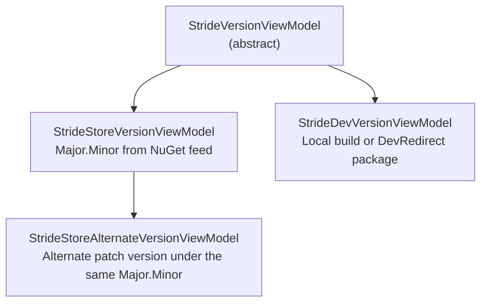

# Stride Versions

Managing Stride versions is the launcher's core responsibility. This file describes how versions are discovered, how install/update/uninstall flows are wired, and where to hook new behavior.

## Version kinds



Each entry in `MainViewModel.StrideVersions` is a row of the version list. A `Major.Minor` has a row for its releases and prereleases, one for its nightly builds (`IsNightly`, "Stride 4.5 Nightly") and one for each tag of custom builds; within a `Major.Minor` the tag rows come first, by tag, then the nightly row, as its builds are newer, then the release row (`StrideVersionViewModel.Compare`). The rows are keyed by `(Major, Minor, Channel)` (`StrideVersionViewModel.ChannelOf`: an empty channel for the releases and prereleases, `nightly`, or the tag). A checkout of the engine has one row of its own (below). A `StrideStoreVersionViewModel` holds both the latest `NugetLocalPackage` installed and the latest `NugetServerPackage` from the feed — that's how the UI knows whether a version is installed, outdated, or download-only.

Nightly builds (`PackageVersion.IsNightly`, `X.Y.Z-nightly.YYYYMMDD.N`, see [versioning.md](../build/versioning.md#nightly-builds)) are kept in their own row so that a release row's default build, "Install latest", the first install and the default active version never move to a nightly. A recent project on a nightly opens with the nightly row, one on a release or prerelease with the release row; the nightlies are listed among its "open with" builds, but the upgrade arrow only suggests them to a project already on a nightly. The rows come from the nightly feed: "Show nightly builds" in the launcher settings adds it to or removes it from the user's NuGet.config (`NugetStore.SetPackageSource`) and refreshes the list (`MainViewModel.ShowNightlyBuilds`); turning it on asks first (unsigned builds, project upgrades not fully tested); installed nightlies stay listed when it's off.

Prereleases (`PackageVersion.IsPrerelease`: a label starting with alpha, beta, preview or rc, as `4.5.0-beta06`, `4.5.3-beta` or `4.5.0-rc.1`) are in the release row, with a BETA badge. The row offers the newest release (`StrideStoreVersionViewModel.ChooseOfferedVersion`): a release is never offered a newer beta as an update, someone on a beta is offered the newest build, beta or not, and a line with only betas offers its newest. As in the CLI, a release is a version without a label (`StrideVersionViewModel.IsReleaseVersion`): a local build packed to the dev feed (`4.5.4-dev4`, with `StrideDevPackages=false`) lands in the release row but is never offered as one. A beta is otherwise reached by picking it in the alternate-versions popup.

Any other label is a custom build, such as a studio's own build of the engine. Its tag (`PackageVersion.CustomTag`) is the word the label starts with, lowercase, without the number after it: `mystudio` for `4.5.3-mystudio.32` and `4.5.3-mystudio32`. Each tag has a row of its own in each `Major.Minor`, with the tag as its badge (cut after 12 characters), and its builds are never offered in another row. A custom build numbered like a nightly (`4.5.3-mystudio.20261114.3`) shows its date on Start and Install, without the NIGHTLY badge.

A nightly row has no release notes: its notes button is "What's new" (`StrideStoreVersionViewModel.WhatsNewCommand`), a GitHub compare page to the newest nightly, from the newest installed nightly when older, else from the newest release or prerelease before it (of any line, never a local build: 4.4.0 for the 4.5.0 nightlies until the first 4.5 prerelease), else from the previous nightly (`ChooseWhatsNewRange`). The commits are read from the packages' nuspec (`<repository commit>`): an installed package's own, or one download of the nuspec from its feed's package base address (`NugetStore.GetRepositoryCommitAsync`). The tooltip names both builds, refreshed after each listing.

The icon before "Switch/update version" lists the versions again (`MainViewModel.RefreshCommand`), installed and on the feeds, so that a version published since the start shows without a restart. It skips the rest of the start: no launcher update check, news, first install, or cleanup of unused packages.

## Version discovery

`MainViewModel.FetchOnlineData` orchestrates three phases:

1. **Local.** `RetrieveLocalStrideVersions` calls `NugetStore.GetPackagesInstalled(MainPackageIds)` and filters with `FilterStrideMainPackages()` ([PackageFilterExtensions.cs](../../sources/launcher/Stride.Launcher/PackageFilterExtensions.cs)). Packages are grouped by `{Major}.{Minor}` and channel.
2. **Server.** `RetrieveServerStrideVersions` calls `NugetStore.FindSourcePackages(MainPackageIds, …)`. If the call returns nothing, `IsOffline` flips on and the UI shows an error with the accumulated log.
3. **Dev.** Dev-redirect packages (detected via `NugetStore.IsDevRedirectPackage`) are added as `StrideDevVersionViewModel` with their real on-disk path from `NugetStore.GetRealPath`: one row per checkout (its `-devN` suffix), in checkout order, with its WPF and Avalonia Game Studios. A checkout builds one version at a time, and the stubs of its older versions only point to its project, so its row shows the version it builds (`StrideDevVersionViewModel.ChooseCheckoutVersion`); the other stubs are hidden, and removed with the row. Additionally, every entry in `LauncherSettings.DeveloperVersions` is added up front.

The same `(Major, Minor, Channel)` key is looked up with `SortedObservableCollection.BinarySearch` to merge local and server state into a single view model. The server listing only adds and updates rows: turning the nightlies off removes the nightly rows that aren't installed first.

## NuGet store

[Stride.Core.Packages.NugetStore](../../sources/assets/Stride.Core.Packages/NugetStore.cs) is a thin facade over NuGet's v3 APIs. The launcher does not call NuGet directly — every operation goes through `NugetStore`:

| Method | Used by |
|---|---|
| `GetPackagesInstalled(ids)` | `RetrieveLocalStrideVersions` |
| `FindSourcePackages(ids, ct)` | `RetrieveServerStrideVersions`, `VsixVersionViewModel.UpdateFromStore` |
| `InstallPackage(id, version, frameworks, progress)` | `PackageVersionViewModel` download flow, `SelfUpdater` |
| `UninstallPackage(package, progress)` | `PackageVersionViewModel` delete flow, `MainViewModel.RemoveUnusedPackages`, `Launcher.UninstallAsync` |
| `GetUpdates(identity, …)` | `SelfUpdater` |
| `PurgeCache()` | `SelfUpdater` after a file swap |

Every call is serialized through `MainViewModel.RunLockTask`, which takes `objectLock` and runs on a background thread.

Progress is reported via `IPackagesLogger` — `MainViewModel` implements it and stores every log line in-memory so the crash report and the "offline" dialog can attach it.

## Install / update flow

1. User clicks **Install** or **Update** on a `StrideVersionViewModel`.
2. `PackageVersionViewModel.Download(true)` runs: it sets `IsProcessing`, calls `NugetStore.InstallPackage`, and updates progress via `OnDownloadProgress`.
3. On completion, `UpdateStatus` recomputes `CanBeDownloaded` / `CanDelete` and the UI re-binds.
4. `MainViewModel.RetrieveLocalStrideVersions` is re-run to refresh the version list and to clean up any newly-unused transitive packages via `RemoveUnusedPackages` (walks `Dependencies` starting from the Stride main packages and uninstalls anything no longer referenced).
5. `UpdateAvailableEditors()` re-scans `tools/` and `lib/` for TFM subfolders containing a Game Studio executable (`Stride.GameStudio.Avalonia.Desktop.exe` on Windows, `.dll` on Linux). `SelectedEditor` is restored from `LauncherSettings.PreferredEditor` if present, otherwise the first editor found is used, and the runtime combo is refreshed for the active version.

## Uninstall flow

Two entry points:

- **Per-version**, from the UI: `PackageVersionViewModel.Delete(removeFromUi: true, confirmPrompt: true)` prompts the user, calls `NugetStore.UninstallPackage`, and updates status.
- **Launcher uninstall**, from `Stride.Launcher.exe /uninstall`, which the setup runs when the launcher is uninstalled (not on an upgrade). [Launcher.cs](../../sources/launcher/Stride.Launcher/Launcher.cs)'s `UninstallAsync`:
  1. Calls `UninstallHelper.CloseProcessesInPathsAsync` for the processes started from the launcher directory: the user closes them (OK to try again) or cancels.
  2. Deletes the `.lock` files and the `.old` files of the last self-update (locked ones are skipped).
  3. Asks whether to also remove the installed Stride versions, with their size. **Keep** is the default: someone reinstalling the launcher wants them back. **Remove** uninstalls the versions and the Stride packages that only they use (`StridePackageReferences.FindRemovable`, the same walk of `Dependencies` as the cleanup after an uninstall in the UI). Local builds and what they use are never removed. The processes running from those packages (Game Studio) are checked first, through `NugetStore.UninstallGuard`.
  4. Cancels the app's `CancellationTokenSource` so the main loop exits.

  With `/quiet` (the setup passes it when the MSI shows no dialog: `msiexec /x … /qn`, or `/qr` as in `winget uninstall`), or when the process has no desktop (`Environment.UserInteractive` is false: SYSTEM or session 0, e.g. Intune), nothing is shown, not even an app: only step 2 runs, and the versions are kept. A dialog there would be invisible, or would block the setup. Removing the versions in a script belongs to the CLI (`stride sdk uninstall <version>`).

`UninstallHelper` also subscribes to `NugetStore.NugetPackageUninstalling` to close lingering processes before each package is removed — this is why it lives as a disposable member on `MainViewModel` (`uninstallHelper`).

## Editor discovery

`StrideVersionViewModel.AvailableEditors` is an `ObservableList<string>` populated by scanning every framework folder of the package install paths (`PackageLayout.FrameworkDirectories`; a dev-redirect version scans `bin/<Configuration>/` of the in-tree project instead). The launcher looks for:

```
{InstallPath}/tools/{framework}/Stride.GameStudio.Avalonia.Desktop.{exe|dll}
{InstallPath}/lib/{framework}/Stride.GameStudio.Avalonia.Desktop.{exe|dll}
```

On Windows, `Stride.GameStudio.exe` is also considered. The first folder holding an editor wins; each editor's folder is remembered for `LocateMainExecutable`. Stride 4.0 shipped both a `net472` and a `net5.0-windows` editor, which is why the legacy `lib/net472/Stride.GameStudio.exe` fallback still exists; since 4.1 every version ships one framework folder per editor.

## Runtime choice

`MainViewModel.AvailableRuntimes` lists ".NET N or newer (default)" for the active version's editor's own runtimeconfig major, then ".NET M or newer" for each .NET major above it, restricted to majors with both a runtime and an SDK installed (`DotNetInstall.Detect`). A choice is a minimum: a project that needs a newer major still gets it, and a `global.json` SDK pin wins over the choice. The list is only shown when the editor takes the choice (`DotNetHostSelector.SupportsHostSelection`, a type-reference scan of the editor assembly), so older editors never receive `--framework`. An explicit choice starts the editor through `dotnet exec --runtimeconfig <generated>`; the default entry passes no choice, starts the apphost and lets the editor re-execute itself when the project needs a newer major.

## VSIX

`VsixVersionViewModel` treats the VSIX as just another NuGet package but overrides the install step to invoke `VSIXInstaller.exe` against the detected `VisualStudioVersions.AvailableInstances` matching the supported range (`VS2019` for major 16, `VS2022AndNext` for major ≥ 17). Two instances exist on `MainViewModel`: `VsixPackage2019` and `VsixPackage2022`.

## Adding a new version kind

1. Create a subclass of `StrideVersionViewModel` (or `StrideStoreVersionViewModel` for "looks like a store version but from a different source").
2. Override `UpdateStatus` to describe when the entry is downloadable vs installed.
3. Populate it from `MainViewModel` — either from a settings source (like `LauncherSettings.DeveloperVersions`) or from a new NuGet query.
4. If the UI needs to distinguish it, add a DataTemplate in `MainView.axaml` keyed on the concrete type.
